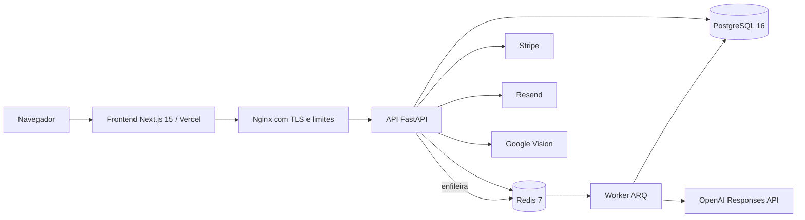
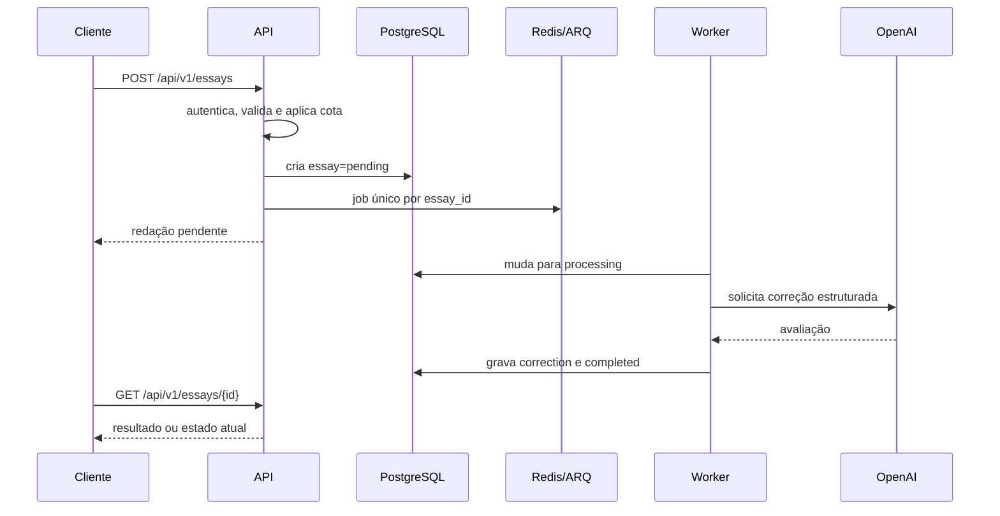

# Arquitetura

## Visão geral



O frontend usa App Router, React 19, TypeScript, Tailwind e Framer Motion. O backend é assíncrono, usa FastAPI/Pydantic, SQLAlchemy/asyncpg, PostgreSQL e Redis. Correções de IA saem do caminho síncrono da API e são processadas pelo worker ARQ.

## Fluxo de uma correção



Jobs usam ID determinístico e a tabela de correções impõe unicidade por redação. Tentativas repetidas não devem produzir duas correções.

## Estrutura do repositório

```text
backend/
  app/api/v1/endpoints/  rotas HTTP
  app/core/              configuração, segurança, middleware, fila
  app/db/models/         modelos SQLAlchemy
  app/schemas/           contratos Pydantic
  app/services/          IA, OCR, Stripe e email
  app/workers/           consumidores ARQ
  alembic/versions/      histórico do schema
  tests/                 unitários, integração e carga
frontend/
  src/app/               páginas e layouts Next.js
  src/components/        componentes de domínio e UI
  src/contexts/          estado global de usuário
  src/lib/api/           cliente HTTP
docs/                    documentação técnica e operacional
nginx/                   proxy reverso de produção
```

## Limites de responsabilidade

- Frontend melhora UX, mas não é fronteira de segurança.
- API autentica, autoriza, valida, aplica cotas e persiste estados.
- Worker executa operações caras e tolera retry.
- PostgreSQL é a fonte de verdade de negócio.
- Redis guarda fila, rate limits e contadores atômicos; em produção usa AOF e `noeviction`.
- Provedores externos devem ser tratados como lentos e potencialmente indisponíveis.

Consulte [Escalabilidade](SCALABILITY.md) para capacidade e backpressure e [Segurança](SECURITY.md) para as fronteiras de confiança.
