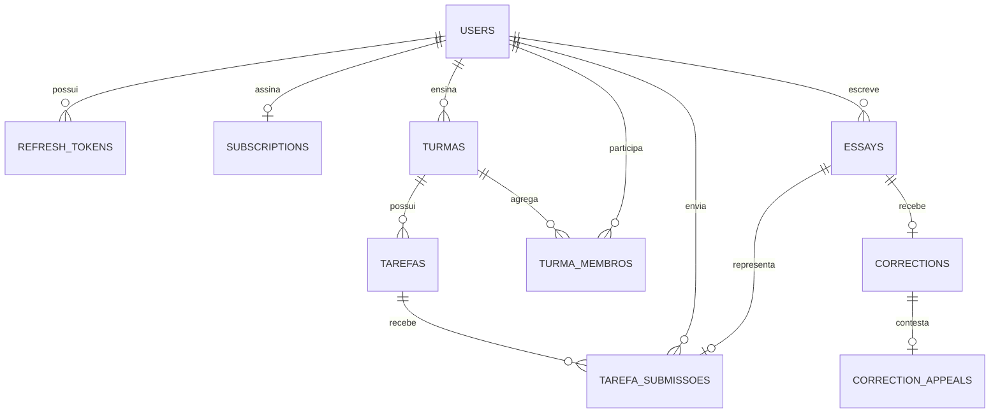

# Banco de dados

PostgreSQL 16 é a fonte de verdade. O acesso é assíncrono via SQLAlchemy e asyncpg; mudanças de schema são versionadas com Alembic.

## Modelo lógico



Tabelas atuais: `users`, `refresh_tokens`, `subscriptions`, `essays`, `corrections`, `turmas`, `turma_membros`, `tarefas`, `tarefa_submissoes` e `correction_appeals`.

## Restrições críticas

- Email de usuário é único.
- Assinatura é única por usuário; IDs Stripe aplicáveis também são únicos.
- Correção é única por `essay_id`.
- Contestação é única por `correction_id`.
- Submissão é única por `(tarefa_id, student_id)`.
- Chaves estrangeiras e filtros de proprietário sustentam integridade e isolamento.

## Migrações

```bash
cd backend
alembic current
alembic history
alembic upgrade head
alembic revision --autogenerate -m "descricao objetiva"
```

Sempre revise uma migração autogerada. Ela não entende intenção de negócio, backfill ou risco de lock. Em produção:

1. Faça backup verificável.
2. Avalie compatibilidade entre versão antiga e nova da aplicação.
3. Execute `alembic upgrade head` uma única vez antes de subir API/worker novos.
4. Faça smoke test e acompanhe erros/locks.

Downgrade só deve ser usado quando a própria migration o suporta sem perda. Para alterações destrutivas, prefira expansão/migração/contração em releases separados.

## Backup e restauração

```bash
pg_dump --format=custom --no-owner --file=redator.dump "$DATABASE_URL_SYNC"
pg_restore --clean --if-exists --no-owner --dbname="$DATABASE_URL_SYNC" redator.dump
```

Use uma URL compatível com ferramentas PostgreSQL (sem `+asyncpg`). Restaure primeiro em ambiente isolado e valide contagens, relações e login antes de considerar o backup confiável. Defina retenção, criptografia e teste periódico de restauração na VPS/provedor.
